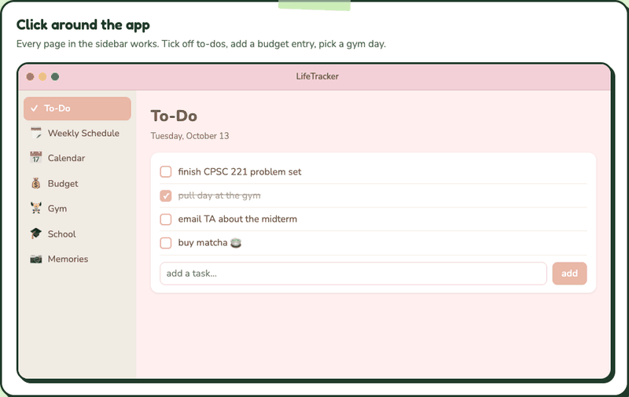

# LifeTracker

A personal life tracker for macOS: weekly plans, calendar, budget, gym log, school, notes and a photo-a-day diary in one app. Everything is stored locally on your Mac.

## Demo



Recorded from the macOS app itself running on made-up sample data. There's also a browser version on my portfolio: [try it here](https://nicole-li7.github.io/projects/lifetracker.html).

## Features

**Weekly Schedule**
- **Day boxes**: one box per day, Monday to Sunday, each with its own task list and a highlight on today.
- **Weekly reset**: when a new week starts (checked when you open the page), one-off tasks are erased; tasks marked with the repeat button stay and get unchecked.

**Calendar**
- **Month grid**: pick a day to see and add its events, with "+N more" when a cell is full.
- **Events**: all-day, or with start and end times, shown in the day panel.
- **School exams**: exams and midterms from your current classes appear automatically (archived classes are left out).
- **Weekly Schedule tasks**: shown read-only on their day (repeating tasks every week, one-off tasks in the current week only).
- **Google Calendar**: optional read-only sync of your calendars (about a year back), with Refresh and Disconnect.

**Budget**
- **Monthly entries**: income and expenses with a description, amount and category (Food, Rent, Transport, Shopping, Fun, Bills, Health, Income, Other).
- **Total balance**: all income minus all expenses up to the end of the month you're viewing, so leftovers carry over.
- **Insights**: spending by category for the month, and income vs. expenses over the last 6 months.

**Gym**
- **Workouts**: Push, Pull and Glutes templates that fill in exercises and target schemes, with core work added to each, or a blank workout.
- **Sets**: log reps and weight (lb) per set; a new set copies the previous one. Exercises and sets are editable.
- **Progress**: line chart of your heaviest set over time for any exercise.

**School**
- **Classes**: a grid of class cards with cover photo, instructor and meeting days, plus a countdown to the next exam. Classes can be archived and restored.
- **Class page**: instructor and email, room, color, syllabus and Canvas links, weekly meeting times, and exams or midterms with date, time and room.
- **Cover photos**: pick or drag in a photo, with a pan-and-zoom editor that frames the card and the banner separately.
- **Lecture notes**: collapsible notes per lecture, with pictures and files attached by pasting (Shift-Cmd-V), dragging in, or browsing (up to 50 MB each). Right-click to open, save a copy or remove.

**Notes**
- **Sticky note board**: free-form notes with a title, text and a color of your choice.
- **Pin and search**: pinned notes sort to the top, the rest by last edit, with a search box.
- **Pictures**: add photos, paste a screenshot (Shift-Cmd-V) or drag one in.

**Memories**
- **Photo a day**: a monthly grid with one photo per day; click an empty day to add one, or "Add Today's Photo".
- **View**: click a photo to enlarge it, then change or remove it. Browse month by month.

**Everywhere**
- **Save Now** (Cmd-S), plus automatic saving when the app quits, hides or loses focus.
- **Look**: a warm pink and cream theme, always in light appearance. The window opens at about 90% of the screen.

## Getting started

Requires macOS 15 or later and Xcode.

```sh
# Debug build
xcodebuild -project LifeTracker.xcodeproj -target LifeTracker -configuration Debug CODE_SIGNING_ALLOWED=NO

# Release build (ad-hoc signed), then install
xcodebuild -project LifeTracker.xcodeproj -target LifeTracker -configuration Release CODE_SIGN_IDENTITY="-"
cp -R build/Release/LifeTracker.app /Applications/
```

You can also open `LifeTracker.xcodeproj` in Xcode and press Run.

Google Calendar is optional. To turn it on, create a Google OAuth client for bundle ID `com.nicole.LifeTracker` and put its client ID in `LifeTracker/GoogleConfig.swift`. Until then the Connect button just asks for it. The app only requests read-only calendar access.

## How it's built

SwiftUI and SwiftData, with Swift Charts for the budget and gym charts. Google sign-in uses OAuth with PKCE through `ASWebAuthenticationSession`.

```
LifeTracker/
  LifeTrackerApp.swift      app entry, data container, save-on-quit
  ContentView.swift         sidebar and page routing
  StoreLocation.swift       store path and automatic backups
  *View.swift               one file per page (Weekly, Calendar, Budget, Gym, School, Notes, Memories)
  BudgetInsightsView.swift  GymProgressView.swift  LectureAttachmentsView.swift
  GoogleCalendarService.swift  GoogleConfig.swift   Google Calendar sync
  GymTemplates.swift        Push / Pull / Glutes / core exercises
  Course.swift Workout.swift ...   SwiftData models
  Theme.swift               colors
```

## Your data

The database is `~/Library/Application Support/LifeTracker/LifeTracker.store`, with large photos and attachments kept in a hidden `.LifeTracker_SUPPORT` folder beside it.

- **Backups**: a copy is made into `Backups/` on every launch and quit, and the newest 40 are kept. Photos are hard-linked, so they take no extra space.
- **Restore**: quit the app and copy a backup over the store. `Backups/HOW TO RESTORE.txt` has the steps.
- **Google**: if you connect, a refresh token is kept in the app's preferences. Events are fetched on demand and not stored.
